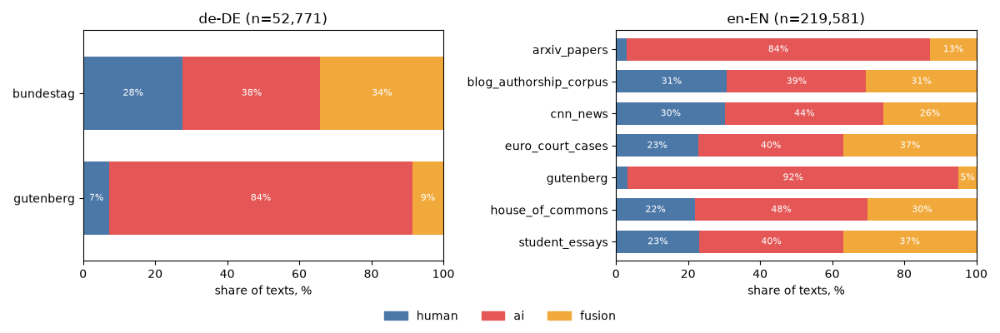
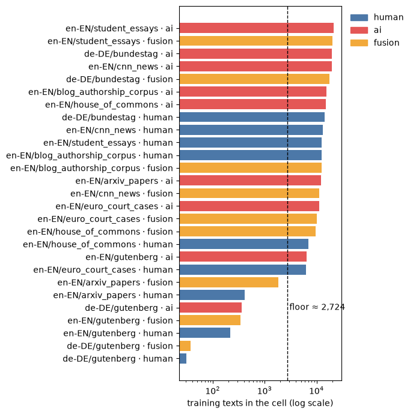
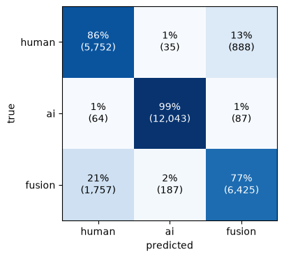
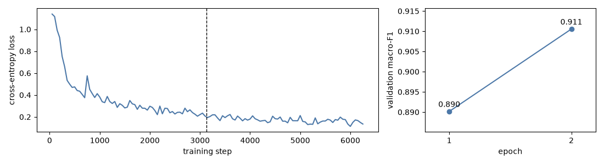
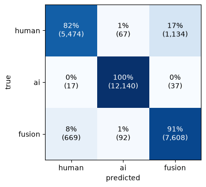
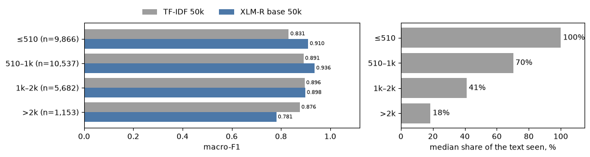
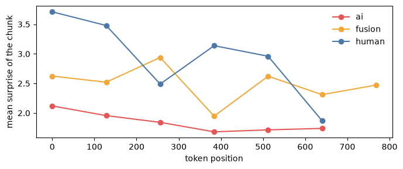
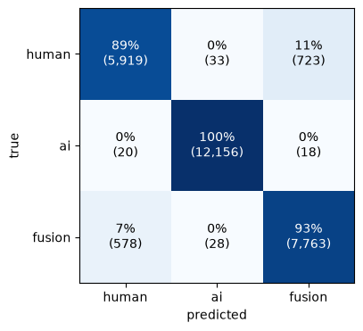
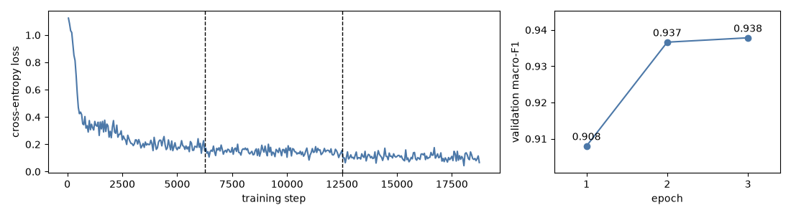
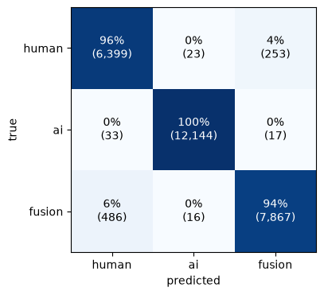

## **Data Analysis**

The dataset contains texts in English and German from different domains, such as arXiv papers, student essays, CNN news, etc. Each text has a label indicating how it was written: by a human, by AI, or by a fusion of both.

The classes are slightly unbalanced: AI texts are the most frequent (25% human, 45% AI, 31% fusion). Languages and domains are unbalanced too: DE Bundestag and EN CNN news have many more samples than DE/EN Gutenberg. Their distribution differs between train and test, but the same imbalance is kept.

All domains, languages and classes contain texts longer than 512 XLM-R tokens. For most combinations, the share of such texts (in a random sample of 20000 from train) is >= 75%, which matters for the encoder ([Table 1](#tab-1): share of texts above 512 tokens per domain and label).

I chose 50000 texts for train and ~27000 for val. A plain random subsample of 50k keeps about 18% of every cell, so a cell with fewer than ~2700 texts would have fewer than 500 examples. Therefore, cells with fewer than 2700 texts are kept whole, and the others are sampled. The val set keeps the original distribution ([Table 2](#tab-2) and [Figure 2](#fig-2): cell sizes in train).

---

## **TF-IDF model**

I calculated the TF-IDF score for 1-2 word grams and 3-5 character grams, kept the 200k most frequent of each, and normalized the values. I tried 3 feature sets: character TF-IDF, word TF-IDF, and both together (400k values). As classifiers I tried a linear Support Vector Machine and Logistic Regression, tuning the inverse regularization term $C$ for both.

Logistic Regression was better in general (the top 4 models use it), and so were words and characters together (the top 2 models). The best model is Logistic Regression on both with $C=3$. It scored 0.870 macro-F1 on val and 0.873 on the public leaderboard ([Table 3](#tab-3): TF-IDF feature sets and models with the $C$ search).

The model is almost perfect on AI texts (99% precision, ~1% missed) but confuses human and fusion texts ([Figure 3](#fig-3): confusion matrix of the TF-IDF model).

---

## **Encoder (XLM-R base)**

I chose the pretrained xlm-roberta-base (XLM-R base) as the encoder. To handle long texts I used the first 128 tokens and the last 382 (+ 2 special tokens), as suggested by Sun et al. [[1](#ref-1)]. I trained for 2 epochs with a learning rate of $2 \cdot 10^{-5}$ ([Figure 4](#fig-4): XLM-R base training curves).

XLM-R base got 0.911 macro-F1 on val and 0.915 on the public leaderboard (0.870/0.873 for the TF-IDF model). Like the TF-IDF model, it handles AI texts perfectly but confuses human and fusion texts, though less ([Table 4](#tab-4): XLM-R base metrics, [Figure 5](#fig-5): confusion matrix of XLM-R base).

---

## **Experiments and final pipeline**

### **Chunking**

The main issue of the encoder is that it does not see the middle of the text. XLM-R base scores worse on long texts (> 2000 tokens) than on shorter ones (510-1000): macro-F1 0.781 against 0.936 ([Figure 6](#fig-6): macro-F1 of XLM-R base by text length).

To handle this I split each text into at most 8 chunks and predicted 3 logits for each. To combine them, I took the mean of the logits or probabilities, or replaced the mean of the fusion logit by its max; all worsened macro-F1 by ~0.01 compared to XLM-R base without chunking. Instead, I used the predictions for all chunks as input to a stacker model (Logistic Regression), which gave a great improvement: 0.911 (XLM-R base) vs 0.917 (logit stacker) vs 0.938 (window-feature stacker) ([Table 5](#tab-5): XLM-R base and stacker comparison, [Figure 7](#fig-7): confusion matrix of the window-feature stacker).

### **Perplexity**

Another experiment used an open-weight LM (Qwen2.5-0.5B). The surprise of a token is its negative log-probability $s_i = -\log p_\theta(t_i \mid t_{<i})$, averaged over 128-token chunks. The idea is that AI-generated text is easier to predict, so the model is less "surprised". [Figure 8](#fig-8) (mean surprise per chunk for 3 random texts) confirms this: the AI text is clearly less surprising. From the chunk surprises I built 5 features for the stacker: mean, std, spread, min and max. They did not help: the stacker on probabilities scored 0.917, the same as with them added, and on surprise features alone it was much worse (0.504).

### **Larger model, more data and more epochs**

I trained the larger xlm-roberta-large (XLM-R large, ~560M parameters vs ~270M for base) for 3 epochs on 100k texts instead of 50k. I also retrained the TF-IDF model on 100k texts.

XLM-R large improved over XLM-R base (0.938 vs 0.911) and confuses human and fusion texts less ([Figure 9](#fig-9): confusion matrix of XLM-R large). The third epoch did not add much, so two epochs were likely enough ([Figure 10](#fig-10): XLM-R large training curves). The TF-IDF model also showed a slight improvement (0.869 vs 0.880) ([Table 6](#tab-6): XLM-R large and TF-IDF model on 50k vs 100k texts).

### **Final model**

For the final model I used a stacker and tried all combinations of its input features: the logits of XLM-R large, the TF-IDF class scores, the window features of XLM-R base and XLM-R large, and the surprise features. Each combination was scored with a Logistic Regression stacker by 5-fold CV on out-of-fold predictions ([Table 7](#tab-7): macro-F1 of stacker input combinations). For the best combination, XGBoost beat Logistic Regression as the stacker (0.964 vs 0.960).

The final model (XGBoost stacker on the best combination) is the best of all on both val and the public leaderboard (0.964 and 0.963). The confusion matrix has 96%, 100% and 94% on the diagonal, with only slight confusion between human and fusion texts ([Figure 11](#fig-11): confusion matrix of the final model). [Table 8](#tab-8) compares all models.

---

## **Reproducing results**

Clone the [repo](https://github.com/BohdanZasymovych/ai-hw3-ai-text-detection) and run `python3 reproduce.py`; it saves `submission_final.csv` and `submission_final_logreg.csv` to `artifacts/`.

## **Appendix**

**Figure 1.** Share of each label per domain.

**Table 1.** Share of texts above 512 XLM-R tokens per language, domain and label (random sample of 20000 texts from train).

| lang | domain | human | ai | fusion |
|---|---|---|---|---|
| de-DE | bundestag | 83% | 76% | 91% |
| de-DE | gutenberg | 100% | 84% | 100% |
| en-EN | arxiv_papers | 100% | 92% | 100% |
| en-EN | blog_authorship_corpus | 17% | 17% | 13% |
| en-EN | cnn_news | 86% | 82% | 73% |
| en-EN | euro_court_cases | 82% | 78% | 80% |
| en-EN | gutenberg | 80% | 95% | 82% |
| en-EN | house_of_commons | 67% | 79% | 63% |
| en-EN | student_essays | 42% | 51% | 38% |

**Table 2.** Number of train texts per language, domain and label (cell sizes).

| lang | domain | human | ai | fusion |
|---|---|---|---|---|
| de-DE | bundestag | 14,479 | 19,977 | 17,887 |
| de-DE | gutenberg | 31 | 360 | 37 |
| en-EN | arxiv_papers | 407 | 12,050 | 1,833 |
| en-EN | blog_authorship_corpus | 12,466 | 15,684 | 12,397 |
| en-EN | cnn_news | 13,395 | 19,488 | 11,402 |
| en-EN | euro_court_cases | 6,277 | 11,141 | 10,160 |
| en-EN | gutenberg | 216 | 6,359 | 341 |
| en-EN | house_of_commons | 6,953 | 15,298 | 9,608 |
| en-EN | student_essays | 12,506 | 21,583 | 20,017 |

**Figure 2.** Cell sizes (language, domain, label) in train, sorted by size on a log axis.

**Table 3.** TF-IDF feature sets and classifiers with the $C$ search.

| features | model | C | macro-F1 |
|---|---|---|---|
| word+char | LogisticRegression | 3 | 0.870 |
| word+char | LogisticRegression | 10 | 0.869 |
| char | LogisticRegression | 3 | 0.863 |
| char | LogisticRegression | 10 | 0.858 |
| word+char | LinearSVC | 0.3 | 0.852 |
| word+char | LinearSVC | 0.1 | 0.850 |
| char | LinearSVC | 0.3 | 0.850 |
| word+char | LinearSVC | 1 | 0.848 |
| char | LinearSVC | 1 | 0.847 |
| word | LogisticRegression | 3 | 0.847 |
| word | LogisticRegression | 10 | 0.843 |
| char | LinearSVC | 0.1 | 0.841 |
| word | LinearSVC | 0.3 | 0.824 |
| word | LinearSVC | 0.1 | 0.818 |
| word | LinearSVC | 1 | 0.817 |

**Figure 3.** Confusion matrix of the TF-IDF model.

**Figure 4.** Training curves of XLM-R base.

**Table 4.** Metrics of XLM-R base.

| class | precision | recall | f1 | support |
|---|---|---|---|---|
| human | 0.889 | 0.820 | 0.853 | 6,675 |
| ai | 0.987 | 0.996 | 0.991 | 12,194 |
| fusion | 0.867 | 0.909 | 0.887 | 8,369 |
| macro avg | 0.914 | 0.908 | 0.911 | 27,238 |

**Figure 5.** Confusion matrix of XLM-R base.

**Figure 6.** Macro-F1 of XLM-R base by text length.

**Table 5.** Comparison of XLM-R base and the stackers on chunk predictions.

| class | XLM-R base 50k | XLM-R base 50k, window mean | Stack: XLM-R base | Stack: XLM-R base + windows |
|---|---|---|---|---|
| human | 0.853 | 0.612 | 0.868 | 0.902 |
| ai | 0.991 | 0.988 | 0.992 | 0.993 |
| fusion | 0.887 | 0.799 | 0.890 | 0.918 |
| macro avg | 0.911 | 0.800 | 0.917 | 0.938 |

**Figure 7.** Confusion matrix of the window-feature stacker.

**Figure 8.** Mean surprise per 128-token chunk for 3 randomly sampled texts.

**Figure 9.** Confusion matrix of XLM-R large.

**Figure 10.** Training curves of XLM-R large.

**Table 6.** Comparison of XLM-R large and the TF-IDF model trained on 50k and 100k texts.

| class | TF-IDF 50k | TF-IDF 100k | XLM-R base 50k | XLM-R large 100k |
|---|---|---|---|---|
| human | 0.807 | 0.821 | 0.853 | 0.897 |
| ai | 0.985 | 0.987 | 0.991 | 0.996 |
| fusion | 0.815 | 0.833 | 0.887 | 0.920 |
| macro avg | 0.869 | 0.880 | 0.911 | 0.938 |

**Table 7.** Out-of-fold F1 per class and macro-F1 of the logistic regression stacker on every combination of input groups. L: XLM-R large logits, T: TF-IDF 100k class scores, C: window features of XLM-R base, W: window features of XLM-R large, P: perplexity features.

| inputs | n features | human | ai | fusion | macro-F1 |
|---|---|---|---|---|---|
| L + T + C + W | 38 | 0.9348 | 0.9968 | 0.9482 | 0.9600 |
| L + T + C + W + P | 43 | 0.9342 | 0.9969 | 0.9478 | 0.9596 |
| L + C + W | 35 | 0.9331 | 0.9966 | 0.9474 | 0.9590 |
| L + T + W + P | 27 | 0.9327 | 0.9967 | 0.9473 | 0.9589 |
| L + C + W + P | 40 | 0.9331 | 0.9965 | 0.9470 | 0.9589 |
| L + T + W | 22 | 0.9322 | 0.9967 | 0.9467 | 0.9585 |
| L + T + C + P | 27 | 0.9295 | 0.9968 | 0.9438 | 0.9567 |
| L + T + C | 22 | 0.9293 | 0.9968 | 0.9436 | 0.9565 |
| L + W + P | 24 | 0.9280 | 0.9964 | 0.9439 | 0.9561 |
| L + W | 19 | 0.9271 | 0.9964 | 0.9431 | 0.9555 |
| L + C | 19 | 0.9254 | 0.9965 | 0.9406 | 0.9542 |
| L + C + P | 24 | 0.9255 | 0.9965 | 0.9404 | 0.9541 |
| T + C + W | 35 | 0.9243 | 0.9968 | 0.9398 | 0.9536 |
| T + C + W + P | 40 | 0.9236 | 0.9968 | 0.9393 | 0.9532 |
| C + W + P | 37 | 0.9196 | 0.9961 | 0.9366 | 0.9508 |
| C + W | 32 | 0.9190 | 0.9962 | 0.9362 | 0.9505 |
| T + W | 19 | 0.9177 | 0.9964 | 0.9351 | 0.9498 |
| T + W + P | 24 | 0.9176 | 0.9964 | 0.9350 | 0.9497 |
| L + T + P | 11 | 0.9162 | 0.9966 | 0.9340 | 0.9489 |
| L + T | 6 | 0.9155 | 0.9965 | 0.9337 | 0.9486 |
| W | 16 | 0.9088 | 0.9962 | 0.9296 | 0.9449 |
| W + P | 21 | 0.9089 | 0.9962 | 0.9295 | 0.9448 |
| L + P | 8 | 0.8993 | 0.9964 | 0.9211 | 0.9389 |
| L | 3 | 0.8981 | 0.9964 | 0.9206 | 0.9384 |
| T + C + P | 24 | 0.8974 | 0.9943 | 0.9155 | 0.9357 |
| T + C | 19 | 0.8966 | 0.9939 | 0.9142 | 0.9349 |
| C | 16 | 0.8875 | 0.9912 | 0.9049 | 0.9279 |
| C + P | 21 | 0.8864 | 0.9910 | 0.9040 | 0.9271 |
| T + P | 8 | 0.8172 | 0.9878 | 0.8367 | 0.8806 |
| T | 3 | 0.8175 | 0.9869 | 0.8362 | 0.8802 |
| P | 5 | 0.3054 | 0.7316 | 0.4758 | 0.5043 |

**Figure 11.** Confusion matrix of the final model.

**Table 8.** F1 per class and macro-F1 on val for all models, and the public leaderboard score where submitted ("-" otherwise). Stackers are scored out-of-fold.

| model | human | ai | fusion | macro-F1 | public LB |
|---|---|---|---|---|---|
| TF-IDF 50k | 0.807 | 0.985 | 0.815 | 0.869 | 0.873 |
| TF-IDF 100k | 0.821 | 0.987 | 0.833 | 0.880 | - |
| XLM-R base 50k | 0.853 | 0.991 | 0.887 | 0.911 | 0.915 |
| XLM-R base 50k, window mean | 0.612 | 0.988 | 0.799 | 0.800 | - |
| Stack: XLM-R base | 0.868 | 0.992 | 0.890 | 0.917 | - |
| Stack: XLM-R base + windows | 0.902 | 0.993 | 0.918 | 0.938 | - |
| Stack: perplexity | 0.305 | 0.732 | 0.476 | 0.504 | - |
| Stack: XLM-R base + perplexity | 0.869 | 0.992 | 0.891 | 0.917 | - |
| XLM-R large 100k | 0.897 | 0.996 | 0.920 | 0.938 | - |
| Stack: XLM-R large | 0.898 | 0.996 | 0.921 | 0.938 | - |
| Stack: XLM-R large + base windows | 0.927 | 0.996 | 0.942 | 0.955 | - |
| Stack: XLM-R large + large windows | 0.927 | 0.996 | 0.943 | 0.956 | - |
| Stack: XLM-R large + both windows | 0.934 | 0.997 | 0.948 | 0.959 | - |
| Final model, logistic regression stacker | 0.9348 | 0.9968 | 0.9482 | 0.9600 | - |
| Final model, XGBoost stacker | 0.9415 | 0.9963 | 0.9532 | 0.9637 | 0.9632 |

---

## **References**

[1] C. Sun, X. Qiu, Y. Xu, X. Huang. [*How to Fine-Tune BERT for Text Classification?*](https://arxiv.org/abs/1905.05583) In Chinese Computational Linguistics (CCL), 2019.
